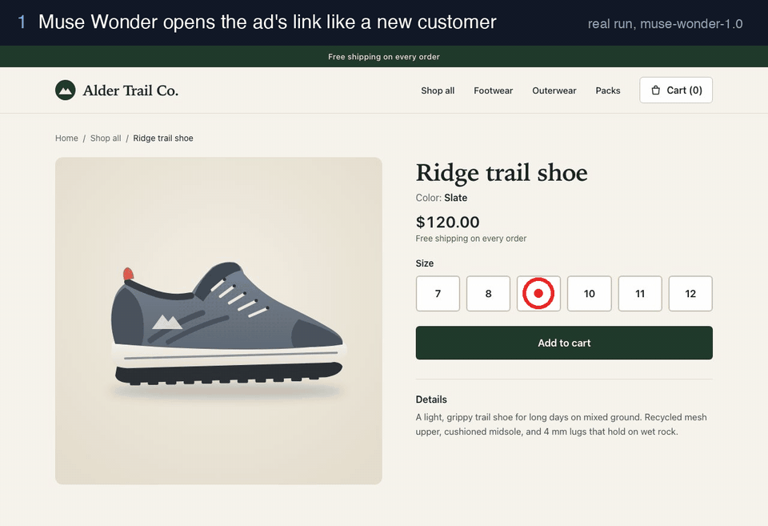
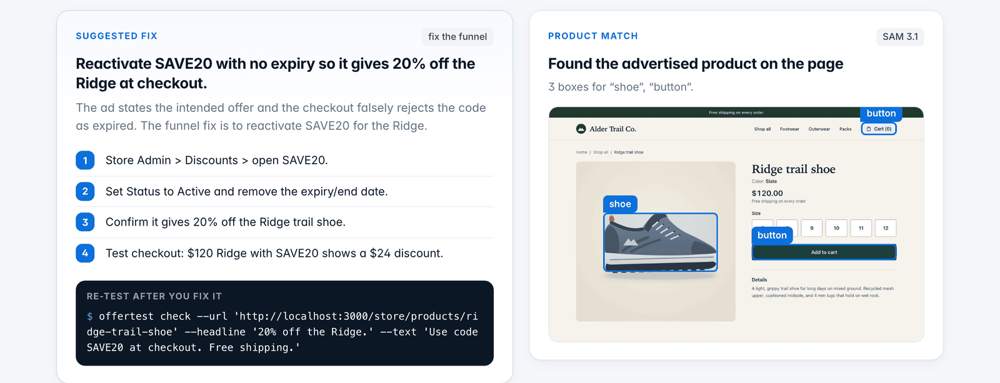
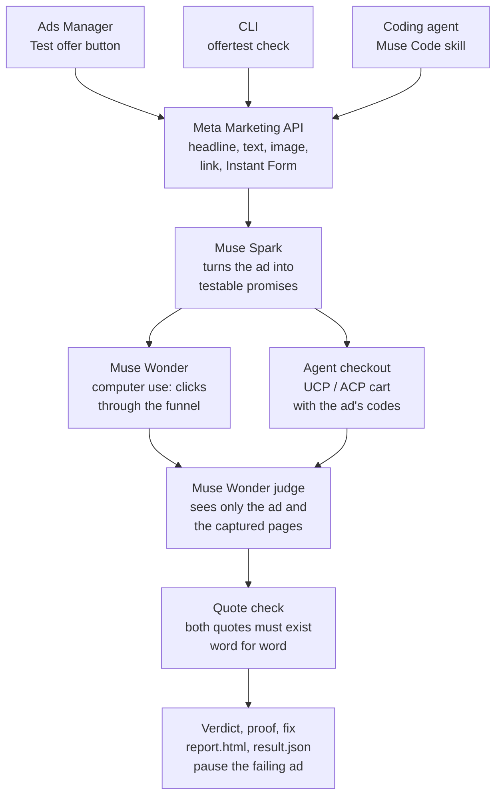
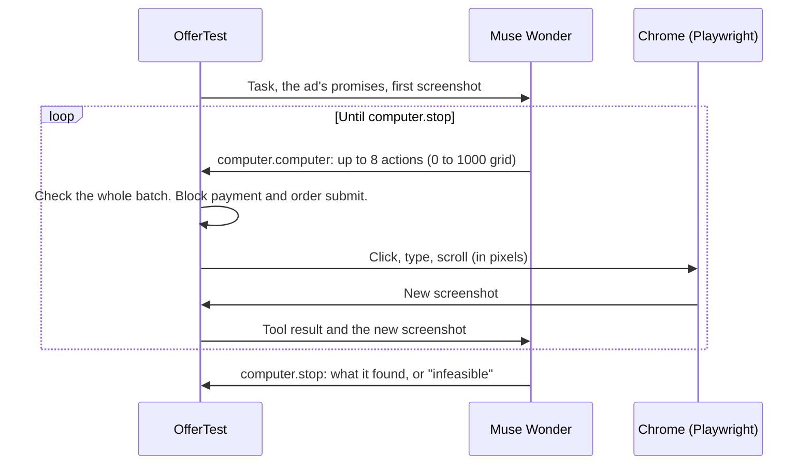

<p align="center">
  
</p>

<h3 align="center">Your ad makes a promise. OfferTest checks that the customer actually gets it, before you pay for the clicks.</h3>

<p align="center">
  An AI agent on Meta's <b>Muse Wonder</b> clicks through your ad's funnel like a real customer.<br>
  It tests every promise in the ad and proves each verdict with word-for-word quotes and screenshots.
</p>

<p align="center">
  
  
  
  
  
  
</p>

<p align="center">
  <a href="#quickstart">Quickstart</a> ·
  <a href="#results">Results</a> ·
  <a href="#how-it-works">How it works</a> ·
  <a href="#built-on-meta-ai">Meta AI</a> ·
  <a href="#three-ways-to-use-it">Ads Manager, CLI, skill</a>
</p>

<p align="center">
  
</p>

## The problem

Every ad makes a promise: a price, a code, free shipping, a 30-day free trial, a free guide. When the funnel breaks that promise (the code expired, the trial asks for a card, the download link is dead), you still pay for every click, and you lose the sale.

Nobody checks this today. Advertisers click through by hand once, if they have time, and the store changes after that. Google tests promo codes before it shows a merchant promotion. Nothing does that for a Meta ad.

OfferTest does. It starts from the ad in Ads Manager, opens the link in a fresh browser, and does what a customer does: picks a size, adds to cart, types the code, goes to checkout. It stops before payment. Then it tells you which promises hold, which break, the proof, and the fix.

## A real run

The demo store's code SAVE20 expired. The ad still says "20% off". This is the actual output (12 agent steps, 3 minutes, $0.67):

```
$ npx offertest check --url http://localhost:3000/store/products/ridge-trail-shoe \
    --headline "20% off the Ridge." --text "Use code SAVE20 at checkout. Free shipping."

OfferTest "20% off the Ridge." -> http://localhost:3000/store/products/ridge-trail-shoe
● Reading the ad's promises (Muse Spark)
● Following the funnel like a customer (Muse Wonder · computer use)
   1 Open localhost:3000/store/products/ridge-trail-shoe
   2 Click (897, 412)
   ...                                   (checks sizes 7 to 12)
   9 Click (940, 494)                    (Add to cart)
  10 Click (936, 345) · Type "SAVE20"
  11 Click (1114, 345)                   (Apply)
  12 Click (987, 634)                    (Checkout)
● Judging each promise against word-for-word evidence (Muse Wonder + quote check)
● Proposing one fix (Muse Wonder)

FAIL  Followed the funnel to localhost:3000/store/checkout  $0.67
  ✗ Code SAVE20 gives 20% off the Ridge
      ad: "20% off the Ridge"   funnel: "This code has expired."
  ✓ Free shipping is available
      ad: "Free shipping"   funnel: "Shipping: $0.00"

  Fix: Reactivate SAVE20 with no expiry so it gives 20% off the Ridge at checkout.
    - Store Admin > Discounts > open SAVE20.
    - Set Status to Active and remove the expiry/end date.
    - Confirm it gives 20% off the Ridge trail shoe.
    - Test checkout: $120 Ridge with SAVE20 shows a $24 discount.

  Report: offertest-runs/20261031004532-8d40c3/report.html
```

Every run writes a one-file HTML report, a `result.json` for scripts and agents, an append-only `log.jsonl`, and every screenshot:

<p align="center">
  
</p>

<p align="center">
  
</p>

## Results

We built a store, **Alder Trail Co.** ([examples/demo-store](examples/demo-store)), with 13 switchable offer bugs: expired code, wrong percent, missing code, code that excludes the product, hidden minimum spend, raised price, shipping charged, sold-out size, trial that demands a card, broken download link, a code that works on the website but not in agent checkout, and more. We froze the labels before the scored run.

<!-- EVAL_TABLE -->
Scored run on 30 Oct 2026 with the real Meta models: 41 ads, 17 with working offers and 24 with broken ones.

| | OfferTest agent | Landing-page check (one model call, no clicks) |
|---|---|---|
| Correct verdicts | **41 / 41** (95% CI 91 to 100%) | 12 / 41 (95% CI 18 to 44%) |
| Broken offers caught | **24 / 24** | 9 / 24 |
| Broken offers passed as fine | **0** | 2 |
| Working offers failed (false alarms) | **0** | 0 |
| Unresolved | 0 | 27 |
| Cost | $12.58 ($0.31 per ad) | $2.38 ($0.06 per ad) |
| Time | 71 min (about 1.7 min per ad) | 18.5 min |

A landing-page check cannot see the cart, the checkout, the sign-up, or the download, so most broken offers are invisible to it. The agent has to click to find them. Full results: [eval/results/latest.json](eval/results/latest.json). Run it yourself: [eval/README.md](eval/README.md).

## Quickstart

Needs Node 22+ and a [Meta Model API key](docs/SETUP.md#1-meta-model-api-key-required-1-minute).

```bash
npx offertest init      # guided setup, about 3 minutes: API key, Ads Manager, browser, agent skill
npx offertest check     # test every ad about to launch in your ad account
```

No ad account? Test any page with the ad's words:

```bash
npx offertest check --url https://yourstore.com/products/x --headline "20% off" --text "Use code SAVE20"
```

`offertest doctor` checks your setup and prints the fix for anything wrong. Step-by-step setup, including every Meta permission and what it is for: [docs/SETUP.md](docs/SETUP.md).

## How it works



1. **Read the ad.** OfferTest pulls the real ad from Ads Manager: headline, text, image, button, link, and the destination type.
2. **Find the promises.** Muse Spark writes each promise in the ad as a test, with a word-for-word quote from the ad.
3. **Follow the funnel.** Muse Wonder drives a fresh Chrome session with no cookies, like a new customer. It sees screenshots and sends clicks and keystrokes. A guard in the browser blocks the final pay button and order-submit requests.
4. **Check agent checkout too.** For store ads, OfferTest also builds a cart in the store's AI-agent checkout (UCP or ACP), where shoppers who buy through AI agents land.
5. **Judge.** Muse Wonder judges each promise from the ad and the exact text of every page. It never sees the agent's own opinion of how the run went.
6. **Check the quotes.** Code checks that both quotes exist word for word, with number boundaries ("$24.00" does not match "$124.00"). A verdict that fails the check becomes `unresolved`, not a guess.
7. **Fix.** For each failure, Muse Wonder proposes one change and where to make it. You fix it and run the same command again.

## Built on Meta AI

| Meta tool | Job in OfferTest |
|---|---|
| **Muse Wonder** (`muse-wonder-1.0`) | Computer use: follows the funnel from screenshots. Judges each promise. Writes the fix. |
| **Muse Spark** (`muse-spark-1.3`) | Reads the ad's text and image and turns them into typed, testable promises. |
| **SAM 3.1** (`sam-3.1`) | Boxes the advertised product and the buttons in a screenshot, so the report shows the product the agent found. |
| **Meta Marketing API** | Pulls the real ad, its destination, and Instant Forms from Ads Manager. Pauses failing ads. |
| **Muse Code** | Runs OfferTest through the skill in [`skills/offertest`](skills/offertest). |

### The computer-use loop

The Meta Model API has no built-in computer tool. OfferTest gives Muse Wonder two function tools, `computer.computer` (a batch of actions on a 0 to 1000 grid) and `computer.stop` (the final answer), and runs the actions itself in a real browser with Playwright.



### What we learned building on Muse Wonder

Meta asked teams to report where the tools need to improve. These are the problems we hit, and how OfferTest handles each one:

| Problem | What OfferTest does |
|---|---|
| The API rejects a `computer` tool type (`400 Unsupported tool type`). | Defines `computer.computer` and `computer.stop` as function tools and maps the 0 to 1000 grid to pixels, clamped to the screen. |
| Long runs sometimes fail with `referenced response not found or expired`. | Retries once. Then it starts a fresh conversation with the latest screenshot and a summary of the progress so far, and the run continues. A journey test makes the API lose the chain twice. |
| The model sometimes sends a bad action in the middle of a batch (a click with no coordinate, then typing). | Checks the whole batch before it runs any of it. One bad action means nothing runs, so it never types into the wrong field. |
| The model can search for a missing item for a long time, which costs money. | The instructions tell it to stop after two different tries and report "not found". The judge then marks that promise `unresolved` or `contradicted` from the evidence. |
| A model can say a test passed when it did not. | The judge never sees the agent's opinion, and code checks every quote word for word. |

## Three ways to use it

**1. Inside Ads Manager.** The [Chrome extension](extension/) adds a **Test offer** button. Select ads, click the button, and the side panel shows each promise with the ad's words next to what the funnel shows. You can pause a failing ad from the panel. It runs on your computer through `offertest serve`.

**2. From the command line.**

| You want to | Run |
|---|---|
| Check every ad about to launch | `offertest check --account act_123` |
| Audit live ads | `offertest check --account act_123 --live` |
| Check one ad | `offertest check --ad <id>` |
| Pause live ads whose offer is broken | `offertest check --account act_123 --live --pause-failing` |
| See your ads and where they send people | `offertest ads` |
| Use it in CI | `offertest check --json`: exit 0 pass, 1 fail, 2 unresolved, 3 error |

**3. From your coding agent.** The same skill works in **Muse Code**, Claude Code, and Codex:

```bash
muse skills install ./skills/offertest            # Muse Code
cp -r skills/offertest ~/.claude/skills/          # Claude Code
cp -r skills/offertest ~/.agents/skills/          # Codex
```

Then ask: *"Check the ads I'm about to launch."* The agent runs OfferTest, reads `result.json`, and tells you what broke and how to fix it.

## What it checks

| Ad destination | What OfferTest does |
|---|---|
| Website: store, landing page, booking, sign-up, free trial, download | Muse Wonder clicks through it like a customer, up to the payment step |
| Store with AI-agent checkout (UCP, ACP) | Builds a cart with the ad's codes and reads the real totals. [Details](docs/AGENT-CHECKOUT.md) |
| Instant Form (lead ad) | Reads the form from Meta, then follows the thank-you button to its page |
| Carousel or dynamic creative | Tests each card's or variant's own link and promise |
| Messenger, WhatsApp, Instagram Direct | Checks the welcome message against the ad's offer |
| App install | Opens the store page |

**Safe by default.** It never pays real money: it stops at the payment step. With `--pay` (test-mode stores only, such as Stripe test mode) it asks you before the final click. Pausing an ad needs the `--pause-failing` flag or a click in the extension. Permissions: [docs/SETUP.md](docs/SETUP.md).

## Development

```bash
npm install
npm test                       # unit tests
npm run typecheck
(cd examples/demo-store && npm install && npm run dev)   # demo store on :3000
npm run test:e2e               # browser tests (needs the demo store)
npm run test:journeys          # 46 user journeys, about 7 minutes (needs the demo store)
npm run eval                   # the scored eval with the real Meta models
```

The 46 journey tests run the real `offertest` command, a real browser, and the demo store. Only Meta is faked, with the same API contract as the real Model API and Marketing API. They cover store owners, agencies, lead ads, trials, lead magnets, broken links, payment safety, CI exit codes, the Chrome extension, and AI-agent checkout. They test the wiring. The eval tests the real model's judgment.

Layout: `src/core` (agent, browser, judge), `src/meta` (Meta APIs), `src/report` (HTML report), `skills/` (agent skill), `extension/` (Ads Manager button), `eval/`, `examples/demo-store/`.

## Built at the Meta Global AI Developer Hackathon

Built solo between 27 Oct and 4 Nov 2026, Indie track, problem statement "Build for Your World". Everything in this repo was written during the event. The git history shows it.

License: Apache-2.0
