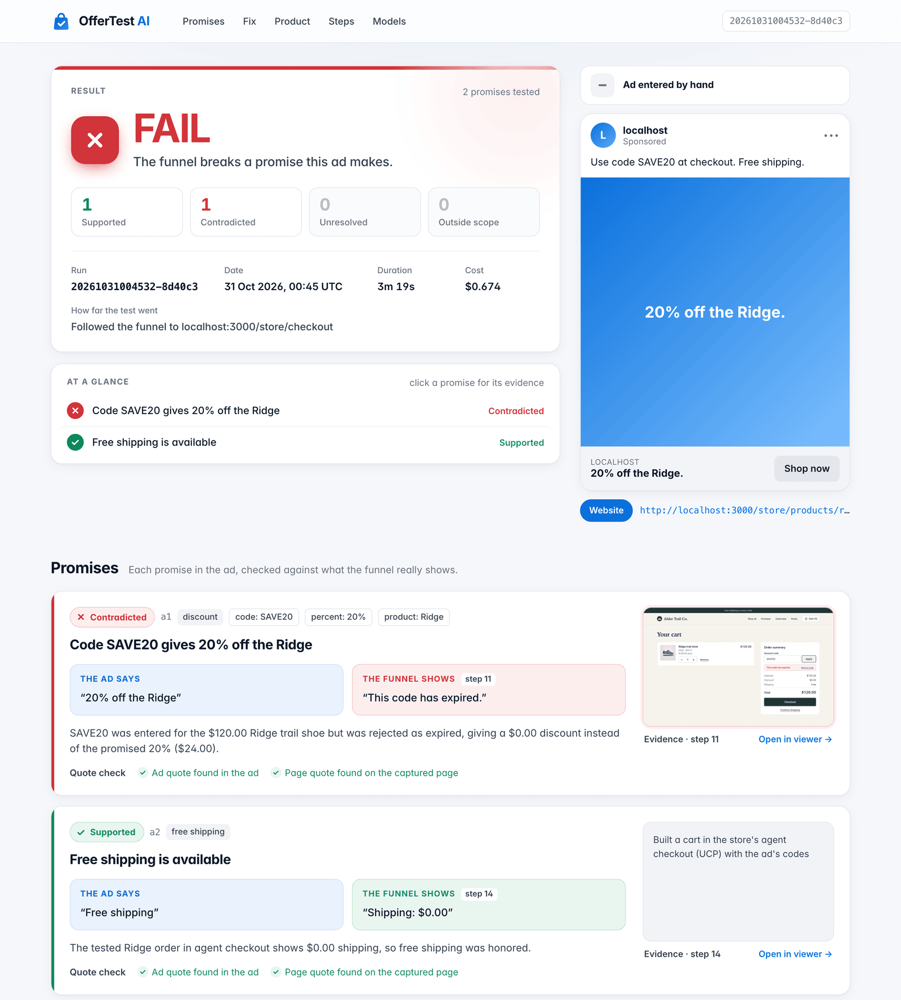
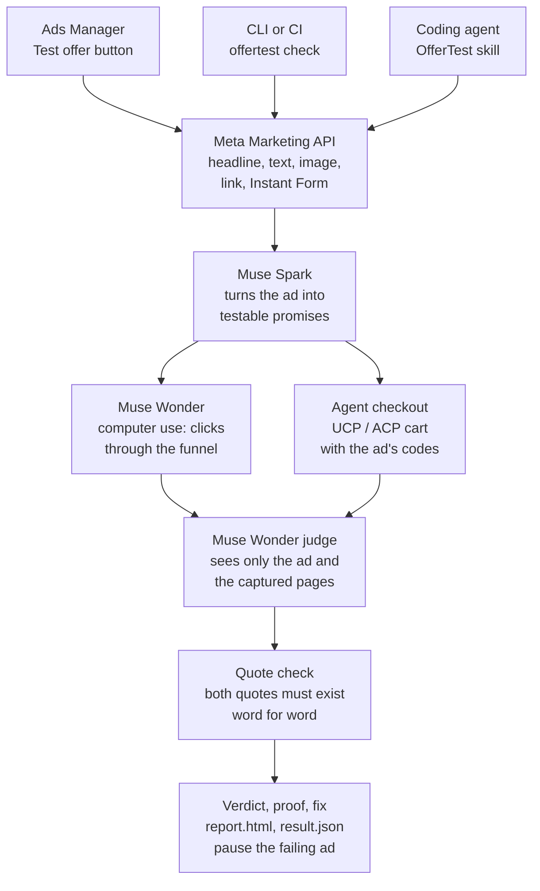

<p align="center">
  
</p>

<h3 align="center">An AI agent that clicks through your ad's funnel like a customer<br>and proves whether every promise in the ad holds.</h3>

<p align="center">
  Discount codes, prices, free shipping, free trials, free downloads. OfferTest reads your Meta ad, tests each promise in the real funnel up to the payment step, and backs every verdict with word-for-word quotes and screenshots. Built on Meta's <b>Muse Wonder</b> computer-use model.
</p>

<p align="center">
  
  
  
  
  <a href="https://github.com/leonardo-vanschaik/offertest-ai/actions/workflows/ci.yml"></a>
  
  
</p>

<p align="center">
  <a href="#quickstart">Quickstart</a> ·
  <a href="#what-it-catches">What it catches</a> ·
  <a href="#accuracy">Accuracy</a> ·
  <a href="#how-it-works">How it works</a> ·
  <a href="#use-it-where-you-work">Ads Manager, CI, agents</a> ·
  <a href="docs/ARCHITECTURE.md">Architecture</a>
</p>

<p align="center">
  
</p>

## Why

An ad that says "20% off with code SAVE20" sends every click to a checkout. If the code expired at midnight, you pay for each of those clicks and lose the sale. Offers break quietly: a discount reaches its end date, a price changes, a size sells out, a theme update hides the code field. Nobody clicks through every ad after every change.

OfferTest does. Run it before an ad launches, on a schedule while it runs, or after every store deploy.

## What it catches

| The ad says | What your customer finds |
|---|---|
| "20% off with code SAVE20" | The code expired at midnight. |
| "20% off" | The cart takes off 10%. |
| "20% off the Ridge shoe" | The code only works on other products. |
| "Save 20% with SAVE20" | The code needs a $150 cart first, and the ad never said so. |
| "Only $120" | The product page shows $135. |
| "Free shipping" | Checkout adds $8.95. |
| "All sizes in stock" | The advertised size is sold out. |
| "30-day free trial, no card" | The sign-up form asks for a card, or the trial is 14 days. |
| "Free guide" | The download link is dead, or the guide costs $4.99. |
| "Use code SAVE20" | It works on the website, but AI shopping agents get "code not valid". |

It works on any funnel a Meta ad can send people to: a store, a landing page, a sign-up or free trial, a booking page, a download, an Instant Form, a carousel, a Messenger or WhatsApp chat, and an app store page.

## Quickstart

**See it work in one minute, with no key.** Needs Node 22.12 or later.

```bash
git clone https://github.com/leonardo-vanschaik/offertest-ai.git
cd offertest-ai
npm install
npx offertest demo
```

The demo replays two real runs that OfferTest recorded with Meta's models on our sample store: the ad fails because the code SAVE20 expired, and after the fix the re-test passes with a test-mode purchase. It checks every recorded file against its SHA-256, runs the quote check again on the recorded pages, and opens the report. No key, no cost. The recordings and how they were made: [examples/recordings](examples/recordings).

**Run it live on the sample store.** Needs a [Meta Model API key](docs/SETUP.md#1-meta-model-api-key-required-1-minute).

```bash
npx offertest init                                        # guided setup: API key, browser, agent skill
(cd examples/demo-store && npm install && npm run dev)    # in a second terminal: the store on :3000
curl -X POST localhost:3000/api/store/scenario -H 'content-type: application/json' -d '{"scenario":"code_expired"}'
npx offertest check --url http://localhost:3000/store/products/ridge-trail-shoe \
  --headline "20% off the Ridge." --text "Use code SAVE20 at checkout. Free shipping."
```

This is the first recorded run, as the terminal showed it (steps 2 to 9 select each size, then add one pair to the cart):

```
● Reading the ad's promises (Muse Spark)
● Following the funnel like a customer (Muse Wonder · computer use)
   1 Open localhost:3000/store/products/ridge-trail-shoe
   ...
  10 Click (936, 345)
  11 Type "SAVE20"
  12 Click (1115, 346)
  13 Click (987, 637)
● Judging each promise against word-for-word evidence (Muse Wonder + quote check)
● Proposing one fix (Muse Wonder)

FAIL  Followed the funnel to localhost:3000/store/checkout  $0.74
  ✗ Code SAVE20 gives 20% off the Ridge.
      ad: "20% off the Ridge."   funnel: "This code has expired."
  ✓ Free shipping is offered.
      ad: "Free shipping."   funnel: "Shipping: $0.00"

  Fix: Reactivate SAVE20 so it again gives 20% off the Ridge at checkout.
    - Store admin > Discounts: open the SAVE20 coupon.
    - SAVE20 > Active dates / Status: set to Active and extend the end date beyond today, 2026-11-02.
    - SAVE20 > Value: confirm 20% off applies to the Ridge Trail Shoe, then save.
    - Check: add the Ridge ($120) to cart, apply SAVE20 at checkout, and verify the $24.00 discount appears with no expired-code message.
```

**Check your own ads.**

```bash
npx offertest check                    # every ad about to launch in your ad account
npx offertest check --url https://yourstore.com/products/x --headline "20% off" --text "Use code SAVE20"
```

Each check writes a folder with a one-file `report.html`, a `result.json` for scripts and agents, a step-by-step `log.jsonl`, and every screenshot. `offertest doctor` checks your setup and prints the fix for anything wrong. Full setup, with every Meta permission and what it is for: [docs/SETUP.md](docs/SETUP.md).

## Accuracy

We tested OfferTest on 41 ads: 17 with working offers and 24 with broken ones, across 13 failure types. We compared it with a landing-page check that uses the same Meta models and the same judge, but reads only the page the ad links to and does not click.

| | OfferTest | Landing-page check |
|---|---|---|
| Correct verdicts | **41 / 41** (95% CI 91 to 100%) | 12 / 41 (95% CI 18 to 44%) |
| Broken offers caught | **24 / 24** | 9 / 24 |
| Broken offers passed as fine | **0** | 2 |
| Working offers failed (false alarms) | **0** | 0 |
| Unresolved | 0 | 27 |
| Model cost per ad | $0.31 | $0.06 |
| Time per ad | about 1.7 min | about 0.5 min |

Most broken offers only show up in the cart, at checkout, after a sign-up, or behind a download link. A check that does not click cannot see them. OfferTest costs more per ad because it drives a real browser through the funnel.

**How we tested.** The 41 cases run against a sample store we built ([examples/demo-store](examples/demo-store)), so the right answer is known for every case. Each case switches on one offer bug. We fixed the labels before the scored run on 30 Oct 2026. Results: [eval/results/latest.json](eval/results/latest.json). Run it yourself: [eval/README.md](eval/README.md).

## How it works



1. **Read the ad.** OfferTest pulls the real ad from Ads Manager: headline, text, image, button, link, and destination type.
2. **Find the promises.** Muse Spark turns each promise into a test, with a word-for-word quote from the ad.
3. **Follow the funnel.** Muse Wonder drives a fresh browser with no cookies, like a new customer. It picks options, adds to cart, types codes, and signs up. For stores, OfferTest also builds a cart in the store's AI-agent checkout ([UCP and ACP](docs/AGENT-CHECKOUT.md)).
4. **Judge with proof.** Muse Wonder judges each promise from the captured pages only. Code then checks that both quotes exist word for word. A verdict without proof becomes `unresolved`, never a guess.
5. **Fix.** For each broken promise you get one change, where to make it, and the command to re-test.

**It never pays.** A guard in the browser blocks the final pay button and order requests. `--no-submit` also stops it before sign-up and lead forms. Details: [docs/ARCHITECTURE.md](docs/ARCHITECTURE.md#safety).

## Use it where you work

**Inside Ads Manager.** The [Chrome extension](extension/) adds a **Test offer** button. Select ads, click it, and the side panel shows each promise with the ad's words next to what the funnel shows. Pause a failing ad from the same panel.

**From the command line.**

| You want to | Run |
|---|---|
| Check every ad about to launch | `offertest check --account act_123` |
| Re-check live ads | `offertest check --account act_123 --live` |
| Check one ad | `offertest check --ad <id>` |
| Pause live ads whose offer broke | `offertest check --account act_123 --live --pause-failing` |
| Test on a phone and the Facebook in-app browser | `offertest check --ad <id> --mobile` |

All commands and options: [docs/CLI.md](docs/CLI.md).

**In CI.** Exit code 0 means every promise holds, 1 means one broke, 2 means unresolved. Re-check live ads every 6 hours with GitHub Actions:

```yaml
on:
  schedule: [{ cron: "0 */6 * * *" }]
jobs:
  offertest:
    runs-on: ubuntu-latest
    steps:
      - uses: actions/checkout@v7
        with: { repository: leonardo-vanschaik/offertest-ai, path: offertest }
      - uses: actions/setup-node@v7
        with: { node-version: 22 }
      - run: npm ci --prefix offertest
      - run: node offertest/dist/cli.mjs check --account ${{ vars.META_AD_ACCOUNT_ID }} --live --json
        env:
          META_API_KEY: ${{ secrets.META_API_KEY }}
          META_ACCESS_TOKEN: ${{ secrets.META_ACCESS_TOKEN }}
      - uses: actions/upload-artifact@v7
        if: always()
        with: { name: offertest-reports, path: offertest-runs }
```

**From an agent.** Muse, or any agent, uses OfferTest through the skill. The CLI is the same engine. The skill works in Muse Code, Claude Code, and Codex. Run `npm link` once in this folder, so the agent can run `offertest` from any folder, then install the skill:

```bash
muse skills install ./skills/offertest            # Muse Code
cp -r skills/offertest ~/.claude/skills/          # Claude Code
cp -r skills/offertest ~/.agents/skills/          # Codex
```

Then ask: *"Check the ads I'm about to launch."* The agent runs OfferTest, reads `result.json`, and tells you what broke and how to fix it.

## Built on Meta AI

| Meta tool | Job in OfferTest |
|---|---|
| **Muse Wonder** (`muse-wonder-1.0`) | Computer use through the funnel, the judge, and the fix |
| **Muse Spark** (`muse-spark-1.3`) | Reads the ad's text and image and writes the promises |
| **SAM 3.1** (`sam-3.1`) | Boxes the advertised product and buttons in the report |
| **Meta Marketing API** | Reads ads, destinations, and Instant Forms. Pauses failing ads. |
| **Muse Code** | Runs OfferTest through the skill |

How the computer-use loop works, and what we changed to make Muse Wonder reliable on long funnels: [docs/ARCHITECTURE.md](docs/ARCHITECTURE.md).

## Docs

- [Setup](docs/SETUP.md): API key, Ads Manager permissions, browser, agent skill
- [CLI reference](docs/CLI.md): commands, options, exit codes, output files
- [Architecture](docs/ARCHITECTURE.md): verdicts, safety, the computer-use loop, tests
- [Agent checkout](docs/AGENT-CHECKOUT.md): UCP and ACP, where AI shopping agents buy
- [Chrome extension](extension/README.md): the Test offer button in Ads Manager
- [Benchmark](eval/README.md): the 41 cases and how to run them

## Development

```bash
npm install
npm test                                                 # unit tests
(cd examples/demo-store && npm install && npm run dev)   # sample store on :3000
npm run test:e2e                                         # browser tests
npm run test:journeys                                    # 46 end-to-end user journeys
```

How to contribute: [CONTRIBUTING.md](CONTRIBUTING.md). Report a security problem: [SECURITY.md](SECURITY.md).

License: Apache-2.0
