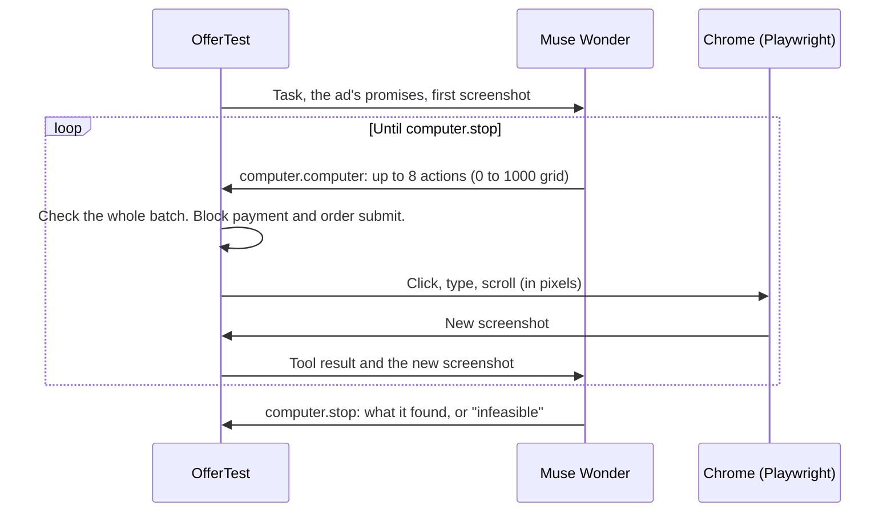

# Architecture

OfferTest turns an ad into tests, runs a computer-use agent through the funnel, and accepts a verdict only when code can find its evidence word for word.

## Models and APIs

| Meta tool | Job |
|---|---|
| **Muse Wonder** (`muse-wonder-1.0`) | Computer use: follows the funnel from screenshots. Judges each promise. Writes the fix. |
| **Muse Spark** (`muse-spark-1.3`) | Reads the ad's text and image and turns them into typed, testable promises, each with a word-for-word quote from the ad. |
| **SAM 3.1** (`sam-3.1`) | Boxes the advertised product and the buttons in a screenshot for the report. |
| **Meta Marketing API** | Pulls the real ad, its destination, and Instant Forms from Ads Manager. Pauses failing ads. |
| **Muse Code** | Runs OfferTest through the skill in [`skills/offertest`](../skills/offertest). |

## How a verdict is made

1. **Read the ad.** From the Marketing API: headline, primary text, image, button, URL parameters, and the destination type. Or from `--url`, `--headline`, and `--text`.
2. **Promises.** Muse Spark writes each promise as a typed test (discount, price, free shipping, trial, download, availability) with a quote from the ad.
3. **Funnel.** Muse Wonder drives a fresh Chrome session with no cookies, like a new customer. OfferTest runs its actions with Playwright and saves the screenshot and the text of every page.
4. **Agent checkout.** For store ads, OfferTest also builds a cart in the store's AI-agent checkout (UCP, and ACP when configured) with the ad's codes. See [AGENT-CHECKOUT.md](AGENT-CHECKOUT.md).
5. **Judge.** Muse Wonder judges each promise as `supported`, `contradicted`, or `unresolved`. It sees only the ad, the promises, and the captured page text. It never sees the agent's own opinion of how the run went.
6. **Quote check.** Code checks that the ad quote and the page quote exist word for word, with number boundaries (`$24.00` does not match `$124.00`). A verdict that fails the check becomes `unresolved`.
7. **Fix.** For each failure, Muse Wonder proposes one change and where to make it, plus the command to re-test.

## Safety

- **No real payments.** A guard in the browser blocks the final pay button and order-submit requests. With `--pay` (test-mode stores only) OfferTest asks you before the final click.
- **Forms.** The agent fills sign-up and lead forms the way a customer would, because the promise (a trial, a download) is often behind them. `--no-submit` stops it before it sends a sign-up, lead, or booking form. It can still apply a code or move to the next step.
- **Ads.** OfferTest pauses an ad only with `--pause-failing` or a click in the extension, and asks first.
- **Cost.** `--max-usd` stops a run above a model cost. `--max-turns` limits the agent's turns.

## The computer-use loop

The Meta Model API has no built-in computer tool. OfferTest gives Muse Wonder two function tools, `computer.computer` (a batch of actions on a 0 to 1000 grid) and `computer.stop` (the final answer), and runs the actions itself in a real browser.

## Notes on building with Muse Wonder computer use

| Problem | What OfferTest does |
|---|---|
| The API rejects a `computer` tool type (`400 Unsupported tool type`). | Defines `computer.computer` and `computer.stop` as function tools and maps the 0 to 1000 grid to pixels, clamped to the screen. |
| Long runs sometimes fail with `referenced response not found or expired`. | Retries once. Then it starts a fresh conversation with the latest screenshot and a summary of the progress so far, and the run continues. A journey test makes the API lose the chain twice. |
| The model sometimes sends a bad action in the middle of a batch (a click with no coordinate, then typing). | Checks the whole batch before it runs any of it. One bad action means nothing runs, so it never types into the wrong field. |
| The model can search for a missing item for a long time, which costs money. | The instructions tell it to stop after two different tries and report "not found". The judge then decides from the evidence. |
| A model can say a test passed when it did not. | The judge never sees the agent's opinion, and code checks every quote word for word. |

## Code layout

| Folder | What is in it |
|---|---|
| `src/core` | The agent loop (`funnel.ts`), the browser driver and guards (`driver.ts`), promises, judge, quote check, fix, UCP and ACP |
| `src/meta` | Marketing API and Model API clients |
| `src/report` | The one-file HTML report |
| `skills/offertest` | The skill for Muse Code, Claude Code, and Codex |
| `extension/` | The Ads Manager Chrome extension |
| `eval/` | The scored benchmark |
| `examples/demo-store` | The sample store with switchable offer bugs |
| `test/` | Unit, browser, and journey tests |

## Tests

- `npm test`: unit tests.
- `npm run test:e2e`: browser tests against the sample store.
- `npm run test:journeys`: 46 user journeys. They run the real `offertest` command, a real browser, and the sample store. Only Meta is faked, with the same API contract as the real Model API and Marketing API. They cover store owners, agencies, lead ads, trials, lead magnets, broken links, payment safety, CI exit codes, the Chrome extension, and AI-agent checkout. They test the wiring. The eval tests the real model's judgment.
